<div align="center">
  <a href="https://github.com/BinRacer/KernLens">
    
  </a>

  <p>
    <a href="./README.md">English</a> | <a href="./README.zh-CN.md">简体中文</a>
  </p>

  <p>
    面向 GDB 的 Linux 内核检查工具 — 从原始内存、页表到 SLUB 内部结构与符号解析。
  </p>

  <p>
    <a href="https://github.com/BinRacer/KernLens/actions/workflows/ci.yml"></a>
    <a href="https://github.com/BinRacer/KernLens"></a>
    <a href="./LICENSE"></a>
    
    
  </p>
</div>

KernLens 给 GDB 增加 **40 个命令**，用来读一个正在运行的 Linux 内核。
每个命令都通过同一个 reader 读真实内存，用可以手算核对的算术解码，并把
结果连同"它来自哪个表项"一起打印出来 —— 所以错误的结果看起来就是错的，
而不是看起来像真的。

`core/` 与 `output/` 是纯 Python，完全不依赖 GDB；只有 `gdb/` 需要
调试目标。

## 看它跑一遍

<p align="center">
  
</p>

这是 6.1.134 捕获的重放，不是实时录像：文字逐字来自
[`tools/tutorial_capture.json`](tools/tutorial_capture.json)，同一段会话也
保存在 [`docs/assets/demo.cast`](docs/assets/demo.cast)，可以用
`asciinema play` 播放。所有数字都在运行时从内核重新推导，而不是假设。

## 它长什么样

一个 2 MiB 映射，逐级走查。走查停下的位置和硬件一致：

```text
VA: 0xffff975280400000
Paging: 4-level  root=0x3010000
pgd      : idx=0x12e entry=0x3010970 value=0x4a01067 -> 0x4a01000
pud      : idx=0x14a entry=0x4a01a50 value=0x4a02067 -> 0x4a02000
pmd      : idx=0x2 entry=0x4a02010 value=0x80000000004000e3 (huge leaf)
Leaf: 2 MiB huge pa=0x400000 offset=0x0
Flags: P RW A D PAT PS NX
```

每行给出索引、**表项自身的地址**、原始值和下一级的去处。`pmd` 上的
`PS` 位就是没有 `pte` 那一行的原因。同一个地址强制按 5 级页表走查：

```text
VA: 0xffff975280400000
Paging: 5-level  root=0x3010000
pgd      : idx=0x1ff entry=0x3010ff8 value=0x3015067 -> 0x3015000
p4d      : idx=0x12e entry=0x3015970 value=0x0
Note: p4d entry is not present
```

SLUB 分配器，其中 `Size` 与 `Obj Size` 的差值就是每个对象的额外开销
（170 个 cache 中的三行）：

```text
Name                         # Objects  Size  Obj Size  order
ext4_groupinfo_4k            22         184   184       0
AF_VSOCK                     25         1280  1232      3
MPTCPv6                      15         2112  2064      3
```

以及空闲链表的编码 —— 这是 use-after-free 追踪器必须算对的部分。
槽位里存的**不是指针**；`freeptr` 和解码后的 `next` 会一起打印：

```text
Slab @ 0xffff975286c57840 page: 0xffffee5d001b15c0
    cache: 0xffff975284e1bc00 dentry  page_bytes=64
    freeptr: offset=96 random=0xae939aafdb096690
    freelist: 0xffff975286c57c00
    objects: 21  inuse=19  frozen=1
    state: frozen
    slab_size: 0x1000
    next: 0x3110c87b0f5be96f decoded=0xffff975286c57000
```

算术是 `next = stored ^ random ^ swab(slot_address)`；`kl-slab details`
把操作数都打印出来，方便手算复核。其余行（`cpu`、`node`）这里省略，
命令的完整输出里有。

## 安装

在 shell 里一条命令：

```console
curl -fsSL https://raw.githubusercontent.com/BinRacer/KernLens/main/install.sh | sh
```

它把 checkout 克隆到 `~/.local/share/kernlens`，往 `~/.gdbinit` 写一个
带标记的块，并在 `~/.local/bin` 生成 `kernlens` 包装脚本。重复执行只会
更新 checkout，不会追加第二个块；`sh install.sh --uninstall` 会移除这个块
和包装脚本，但保留 checkout。和任何安装脚本一样，建议先读
[`install.sh`](install.sh) 再管道执行。

如果你更愿意自己管理 checkout：

```console
git clone https://github.com/BinRacer/KernLens
echo "source $(pwd)/KernLens/gdbinit.py" >> ~/.gdbinit
```

然后：

```gdb
(gdb) file vmlinux
(gdb) target remote :1234
(gdb) kl-base            # 恢复 KASLR 偏移并应用
(gdb) kl-help            # 按分类列出全部命令
```

**先跑 `kl-base`**：在 KASLR 内核上，vmlinux 里的每个符号都还停在链接期
地址，偏移没应用之前解析出来的东西一律不可信。加载 `gdbinit.py` 不会
装任何断点，在 `file vmlinux` 之前 source 也安全。

在调试内核之前，先检查加载路径：

```console
kernlens doctor
```

它会报告宿主 Python、GDB 内嵌的 Python、`~/.gdbinit` 是否 source 了一个
存在的启动文件、GDB 是否真的能 import `kernlens`，以及是否已经连上目标。
`kl-status --doctor` 补充会话内的那一半。提 issue 时把这份报告贴进去。

目前没有 PyPI 发布。启动文件现在是 package data，`kernlens` 控制台脚本会
打印它的路径，所以从这个 checkout 构建的 wheel 可以直接加载，即使 GDB
运行的是自己的解释器：

```console
pip install .
gdb -q -ex "source $(kernlens path)"
```

`kernlens install` 写出的标记块与 `install.sh` 相同，`kernlens path` 只
打印路径、不改任何文件。在第一次发布之前，上面的安装脚本仍是更短的路径，
升级就是 `git pull`（或重跑安装脚本）。开发环境搭建见
[`CONTRIBUTING.zh-CN.md`](CONTRIBUTING.zh-CN.md)。

## 用容器试一遍

演示镜像会从源码编译一个精简的 6.1 内核，在 QEMU 里启动它，再让 GDB
带着 KernLens 连上去。不需要自备调试目标、内核源码树，也不需要
`/dev/kvm`：

```console
docker build -f demo/Dockerfile -t kernlens-demo .
docker run --rm -it kernlens-demo
```

默认会依次运行 `kl-status`、`kl-base`、`kl-kconfig`、`kl-slab info`、
`kl-sym` 和 `kl-walk`。传入一个命令则只运行那一条：

```console
docker run --rm -it kernlens-demo kl-slab info dentry
```

内核在镜像里从源码编译，并去掉了 DWARF，所以这次会话同时也是对 BTF
路径的检验。镜像里有什么、为什么选择编译而不是下载，见
[`docs/en/demo-container.md`](docs/en/demo-container.md)。

## 30 个命令

分组与 `kl-help` 完全一致。`kl-` 形式是你在提示符下敲的；规范的
`kernlens-` 形式是脚本和生成式教程用的。两者始终都能用。每个命令的
全部别名和一句话说明在 [`docs/en/commands.md`](docs/en/commands.md)。

| 分类 | 命令 |
| --- | --- |
| overview (1) 总览 | `kl-status` |
| kernel base & KASLR (1) 基址与偏移 | `kl-base` |
| kernel metadata (6) 内核元信息 | `kl-kcmdline`, `kl-kconfig`, `kl-kdmesg`, `kl-kmod`, `kl-ksyscalls`, `kl-kversion` |
| addresses & page tables (6) 地址与页表 | `kl-addr`, `kl-p2v`, `kl-pageinfo`, `kl-pt`, `kl-v2p`, `kl-walk` |
| memory & symbols (9) 内存与符号 | `kl-bt`, `kl-buddy`, `kl-kbpf`, `kl-kdmabuf`, `kl-kvar`, `kl-read`, `kl-read-field`, `kl-slab`, `kl-sym` |
| CPU topology (3) CPU 拓扑 | `kl-cpu`, `kl-msr`, `kl-percpu` |
| bit & integer primitives (2) 位与整数 | `kl-bits`, `kl-int` |
| output (1) 输出 | `kl-color` |
| help (1) 帮助 | `kl-help` |

每个命令在 [`docs/en/tutorial/`](docs/en/tutorial/) 都有一页：真实捕获的输出、
全部选项，以及如何读这个结果。

命令表看不出来的有两件事。一是 `kl-help <命令>` 给出用法和现成例子，
且 `--help` 在所有命令上都可用，错误信息是引导式的而不是一行 usage。
二是这些命令从不 `stop()` 调试目标 —— 它们只读内存然后返回，所以可以
放进断点处理函数里组合使用。唯一的例外是 `kl-msr --write`：它通过 GDB
的寄存器接口写入 MSR，且必须显式传参，不会作为读操作的副作用发生。

## 当库用

命令只是一层薄壳，底下是 Python API。在 source 过的脚本里直接调用：

```python
# 在 gdbinit.py 之后 source 的任意文件 —— 名字已经装好了
print(split_4(0xffff888000001234))       # KPageTable，不读内存
print(read_kvar("jiffies"))              # 经 facade 读活内存
print(LE.unpack_u32(b"\x34\x12\x00\x00"))  # LE 本身就是 ByteOrderCodec
```

或者正常导入：

```python
from kernlens import KAddr, KPageTable

# (0x111, 0x0, 0x0, 0x1, 0x234) —— 每级一个索引，最外层在前
KPageTable.split_4(0xffff888000001234)
KAddr.is_direct_map(0xffff888000001234)  # True
```

算术那一半不需要调试器，这正是它能在宿主机上被测试的原因。完整参考见
[`docs/zh-CN/api.md`](docs/zh-CN/api.md)。

## 它凭什么不会说假话

本仓库对自己做出的每一句断言都由机器校验，否则就只是"写下来那天正确"
的散文：

- `docs/en/tutorial/` 是**生成**的，来自在真实内核上的捕获；
  `gen_tutorial.py --check` 在页面与捕获不一致时失败。
- README 的演示和 `docs/en/commands.md` 也是生成的：
  `tools/gen_demo.py --check` 比对动画与捕获，
  `tools/gen_commands.py --check` 比对命令表与注册的元数据。
- 示例覆盖度在 `tools/example_manifest.py` 中声明，由
  `tools/check_examples.py --check` 强制执行：声明了但代码里没有会失败，
  只在散文里提到却从未执行的命令同样会失败。
- 不需要调试器的示例在 CI 里真跑；其余的在 GDB 下重放并记录，每次推送
  都把记录和源码比对。
- `docs/en/architecture.md` 里的目录树、`examples/README.md` 里的数字，都
  与实际树和实际测量比对，而不是手写。
- wheel 是**检查过**的，不是假设的：CI 构建 wheel，缺少启动文件或控制台
  脚本时 `tools/check_wheel.py` 会失败 —— 这正是过去"仅源码分发"政策
  想避免的故障。

本页出现的 `kl-*` 命令数由测试对命令注册表校验，所以它不会悄悄变成假的。

## 文档地图

| 文档 | 内容 |
| --- | --- |
| [`docs/en/tutorial/`](docs/en/tutorial/) | 每个命令一页，真实输出 |
| [`docs/en/demo-container.md`](docs/en/demo-container.md) | QEMU 里的内核，从源码构建、开箱可连 |
| [`docs/en/commands.md`](docs/en/commands.md) | 每个命令与别名，生成式 |
| [`docs/zh-CN/api.md`](docs/zh-CN/api.md) | Python API 参考 |
| [`docs/en/architecture.md`](docs/en/architecture.md) | 包结构、API 映射、设计说明 |
| [`docs/en/compatibility.md`](docs/en/compatibility.md) | 实测过什么、预期可用什么、不承诺什么 |
| [`examples/`](examples/README.md) | 可运行脚本，按意图分组 |
| [`docs/en/naming.md`](docs/en/naming.md) | 命令与文件名约定 |
| [`CONTRIBUTING.zh-CN.md`](CONTRIBUTING.zh-CN.md) | 环境搭建、测试、布局生成器 |
| [`SECURITY.md`](SECURITY.md) | 什么算漏洞，以及如何私下报告 |
| [`CITATION.cff`](CITATION.cff) | 如何引用本项目，以及被引用的版本 |
| [`CHANGELOG.md`](CHANGELOG.md) | 全部变更，最新的在前 |

## 环境要求与许可

Python 3.10+，以及一个用 Python 3.10+ 构建的 GDB。这是两个解释器，
不是一个：`kernlens doctor` 会把两者都打印出来，因为"GDB 内嵌的 Python
看不到这个包"是最常见的一次性失败。仅支持 x86_64 内核 —— 页表与
`struct page` 的解码是针对该架构写的。Python 3.12 以下唯一的运行时依赖
是 `typing-extensions`。哪些组合真的跑过、哪些只是预期可用，见
[`docs/en/compatibility.md`](docs/en/compatibility.md)。

尚未发布任何包。安装方式是上面的一条命令、`git clone`，或从这个 checkout
构建 wheel，见[安装](#安装)。wheel 里带有启动文件，`kernlens path` 会打印
它的路径，因为 GDB 要用自己的解释器 source 那个文件。

GPL-3.0-or-later。见 [`LICENSE`](LICENSE)；第三方归属见
[`CREDITS.md`](CREDITS.md)。
